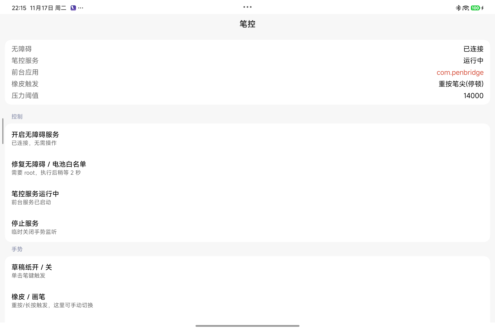

<p align="center">
  
</p>

<h1 align="center">PenBridge 笔控</h1>

<p align="center">
  小米焦点触控笔快捷手势桥接工具 · 粉笔 / 华图做题页增强
</p>

PenBridge 把小米焦点触控笔的笔键和压力事件转成粉笔、华图内的快捷操作：

- **单击笔键**：打开 / 关闭草稿纸，0.45 秒内连击只计算一次。
- **重压笔尖并短暂停留**：切换橡皮擦；抬笔后自动回到画笔。
- **可选长按笔键**：按住笔键 0.6 秒切换橡皮。

本项目需要 **root**。应用不联网、不采集数据，源码全部公开，可自行审计和编译。

> 非官方项目，与小米、粉笔、华图无隶属关系。相关商标归各自权利人所有。

<p align="center">
  
</p>

## 工作方式

系统会优先消费笔键事件，所以仅靠无障碍服务无法稳定收到真实笔键。PenBridge 由两部分协作：

1. `PenService` 通过 root 直接读取 evdev：
   - 笔键：`/dev/input/event18`，上报 `KEY_F19`
   - 笔尖：`event7` / `event8`，读取 `ABS_PRESSURE`
2. `PenAccessibilityService` 负责查找并点击粉笔、华图内部的草稿纸和橡皮控件。

华图的画布会在笔画开始时锁定工具，且驱动会在笔接触屏幕后持续重新断言
`BTN_TOUCH=1`，普通 evdev 注入无法产生有效的 `ACTION_UP`。因此华图模式额外使用
`native/pend.c`：

- 用 `EVIOCGRAB` 独占真实笔节点；
- 用 `uinput` 创建参数一致的虚拟笔转发输入；
- 重压时在虚拟笔上完成一次干净的抬笔、切工具、再落笔。

笔迹本身仍由真实硬件事件驱动，虚拟笔只负责可控地断开当前笔画。

## 环境与兼容性

已在以下环境验证：

- 小米平板 6S Pro（24018RPACC）
- HyperOS 4 / Android 17
- 小米焦点触控笔 Pro
- 粉笔 6.19.11、华图在线
- KernelSU root

最低 Android API 为 26，但 root、evdev 节点和厂商输入驱动均与设备/内核相关，
其他机型不保证可用。

## 安装

1. 从 [Releases](../../releases) 下载 APK。
2. 安装并打开「笔控」。
3. 授予通知权限。
4. 点击「修复无障碍 / 电池白名单 (root)」。
5. 在系统设置中为「笔控」设置：
   - 省电策略：**无限制**
   - 自启动：**允许**
6. 在「手写笔与键盘」中关闭 **轻捏**，避免系统快捷环抢占笔键。

无障碍服务连接后会自动启动笔控前台服务。覆盖安装后无需重新打开 App。

## 使用

在粉笔或华图的做题页中使用：

| 手势 | 操作 |
| --- | --- |
| 单击笔键 | 草稿纸开 / 关 |
| 重压笔尖并停顿约 0.1 秒 | 切换橡皮，抬笔后回画笔 |
| 长按笔键 0.6 秒（可选） | 切换橡皮 |

默认重压阈值为 `14000`。可在 App 内切换为 `12000` 或 `16000`：

- 重压不灵敏：调低到 `12000`；
- 正常写字误触发：调高到 `16000`。

粉笔和画布的按钮 id 可能随版本变化。如果手势失效，请先查看 App 内日志，确认是否
仍能找到对应控件。

## 从源码构建

要求：JDK 17、Android SDK 37、Android Build Tools 37.0.0、root 测试设备。

```bash
cp local.properties.example local.properties
# 编辑 local.properties，写入 sdk.dir

./gradlew :app:assembleDebug
```

构建签名 Release：

```bash
cp keystore.properties.example keystore.properties
# 编辑 keystore.properties，填写自己的 keystore

./gradlew :app:assembleRelease
```

`keystore.properties`、`*.jks` 和 `*.keystore` 已加入 `.gitignore`，不要提交签名密钥。

### 重新编译 native 守护进程

需要 Android NDK：

```bash
ANDROID_NDK_HOME=/path/to/ndk ./native/build.sh
```

脚本会把 aarch64 静态二进制写入 `app/src/main/assets/pend`。

## 调试命令

广播接收器使用首次启动时随机生成的令牌，普通应用无法猜出。读取令牌并发送命令：

```bash
PACKAGE=com.penbridge
TOKEN=$(adb shell "su -c 'cat /data/user/0/$PACKAGE/shared_prefs/*.xml'" \
  | sed -n 's/.*name="cmd_token">\([^<]*\).*/\1/p' | tr -d '\r')

adb shell "am broadcast -n $PACKAGE/.CommandReceiver \
  -a $PACKAGE.CMD --es token '$TOKEN' --es cmd status"
```

常用 `cmd`：`status`、`start`、`stop`、`dump`、`keys`、`scratch`、`eraser`。

## 目录结构

```text
app/                              Android 应用
  src/main/java/.../              Java 手势与无障碍逻辑
  src/main/java/.../MainActivity.kt
  src/main/assets/pend            aarch64 笔转发守护进程
native/pend.c                     守护进程源码
native/build.sh                   NDK 构建脚本
docs/                             Logo
NOTICE                            第三方组件声明
LICENSE                           Apache License 2.0
```

## 隐私

- 应用未声明 `INTERNET` 权限。
- 不包含统计、广告、账号或云同步 SDK。
- 不读取、上传或保存做题内容；日志仅保存在本机内存和 App 私有目录中。
- root 权限仅用于读取笔输入节点、安装 `pend`、执行输入转发和无障碍修复。

## 已知限制

- 依赖 `/dev/uinput`、`EVIOCGRAB` 和厂商输入驱动；换内核或系统可能失效。
- 华图或粉笔更新界面后，控件 id 可能变化，需要同步适配。
- 华图仅在应用位于前台时启用输入转发。
- 本工具不会绕过任何付费、账号或考试限制，请遵守所用服务的使用条款。

## 开源许可

本项目以 [Apache License 2.0](LICENSE) 发布。

第三方组件及其版权声明见 [NOTICE](NOTICE)。界面基于
[Miuix](https://github.com/compose-miuix-ui/miuix) 构建。

酷安发布稿见 [docs/COOLAPK.md](docs/COOLAPK.md)。
