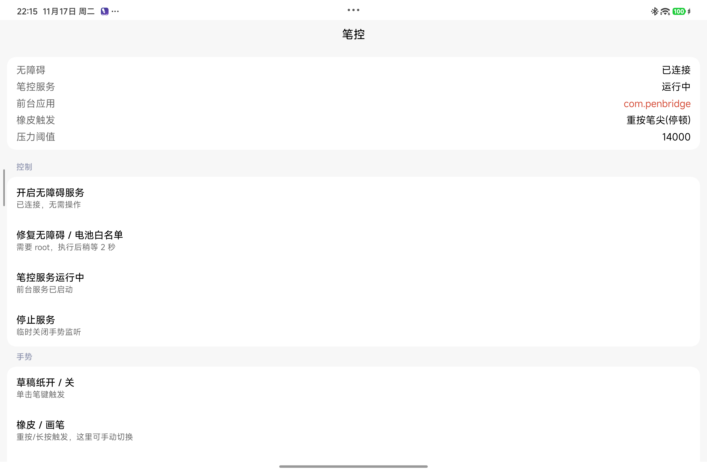

# 让小米焦点笔真正顺手：PenBridge 笔控，一键草稿纸 + 重压橡皮

> 小米平板 6S Pro + 焦点触控笔 Pro 实测可用
>
> 支持粉笔 / 华图做题页 · root 工具 · 开源 · 无联网 · 无广告




## 为什么要做这个工具

用触控笔做题时，最打断思路的不是题目，而是来回找按钮：

- 想在题目旁边打草稿，要先点“草稿纸”；
- 写错了想擦，要先点橡皮；
- 擦完还要再点回画笔。

小米焦点触控笔本身有笔键，但系统会优先接管这个按键，普通无障碍服务很难稳定收到真实笔键。PenBridge 的做法是：用 root 直接读取笔的 evdev 事件，再由无障碍服务去点击粉笔 / 华图里的对应控件。

最终效果很直接：

- **单击笔键**：打开 / 关闭草稿纸；
- **重压笔尖并短暂停留**：切换橡皮；
- **抬笔**：自动回到画笔，不用再点一次。

它不改变 App 本身，也不修改题库内容，只是把手势翻译成 App 内的按钮操作。

## 功能一览

### 1. 单击笔键，草稿纸随手开关

在粉笔或华图的做题页，单击一次笔键即可打开草稿纸，再单击一次关闭。

0.45 秒内的连击只计算一次，避免手抖双击又把刚打开的草稿纸关掉。

### 2. 重压笔尖，切换橡皮

默认规则是：

- 压力 ≥ 14000；
- 在同一位置停留 ≥ 100ms。

满足条件后，当前笔画会立刻断开并切换到橡皮。擦完抬笔，工具会自动恢复成画笔。

正常写字时压力通常不会长时间停在一个点，所以误触概率比较低。实测 29 笔正常写字数据：

- 中位峰值压力约 4825；
- P75 约 7487；
- P90 约 9601；
- 最大约 12628。

默认阈值 14000 留出了足够余量。如果觉得重压不灵敏，可以在 App 里切到 12000；如果写字时容易误触，可以切到 16000。

### 3. 可选长按笔键

如果不习惯重压，也可以在 App 里把橡皮触发方式切到“长按笔键”：

- 按住笔键 0.6 秒；
- 触发橡皮 / 画笔切换。

### 4. 后台自动恢复

无障碍服务连接后会自动拉起笔控前台服务。覆盖安装或重启后，不需要每次先打开 App。

### 5. Miuix 界面和笔尖图标

界面使用 Miuix 构建，主页可以直接看到：

- 无障碍状态；
- 笔控服务状态；
- 当前前台应用；
- 橡皮触发方式；
- 压力阈值；
- 实时日志。

图标是一个倾斜的笔尖加书写弧线，紫色渐变背景。

## 安装要求

### 必需

- 小米平板 6S Pro（当前主要验证机型）；
- 小米焦点触控笔 Pro；
- HyperOS 4 / Android 17（当前验证环境）；
- root，KernelSU 或 Magisk 均可；
- 粉笔 / 华图已安装。

### 重要提醒

这是一个 **root 工具**，不是普通免 root 应用。

它需要读取笔的输入节点，并在华图模式下使用 `/dev/uinput` 创建虚拟笔。没有 root 时，核心手势链路无法完整工作。

## 安装步骤

1. 从 GitHub Releases 下载 `PenBridge-2.1.apk`。
2. 安装并打开「笔控」。
3. 允许通知权限。
4. 点击「修复无障碍 / 电池白名单 (root)」，等待约 2 秒。
5. 进入系统设置 → 应用 → 笔控：
   - 省电策略设为「无限制」；
   - 自启动设为「允许」。
6. 进入系统设置 → 手写笔与键盘：
   - 关闭「轻捏」，避免系统快捷环抢占笔键；
   - 双击动作可以随意设置，PenBridge 不依赖系统双击。

第 5 步很重要。HyperOS 的后台管理如果没有放行，笔控进程可能在使用几分钟后被冻结，表现就是“按笔突然没反应”。

## 使用方法

### 打开草稿纸

在粉笔 / 华图做题页，单击笔键。

### 关闭草稿纸

再次单击笔键。

### 擦除

用笔尖重压并短暂停留，笔迹会在重压位置断开，随后同一笔继续移动就是橡皮。

抬笔后会自动回到画笔，不需要额外点一次工具栏。

### 调节压力阈值

打开「笔控」→「重按压力阈值」：

- 12000：更容易触发；
- 14000：默认；
- 16000：更不容易误触。

### 检查状态

主页状态卡应显示：

- 无障碍：已连接；
- 笔控服务：运行中；
- 前台应用：当前正在使用的粉笔 / 华图。

如果服务没有运行，点「启动笔控服务」。

## 技术实现

这个项目主要解决三个问题。

### 问题一：系统吞掉笔键

焦点笔的笔键在系统里对应：

- 节点：`/dev/input/event18`
- 按键：`KEY_F19`（189）

系统输入服务会优先消费这个按键，无障碍服务的 `onKeyEvent` 收不到稳定事件。

PenBridge 使用 root 直接打开 evdev，读取原始按键事件。这样不依赖系统快捷环，也不需要在系统里绑定动作。

### 问题二：两个 App 的按钮结构不同

粉笔和华图都没有对外提供草稿纸 / 橡皮的快捷接口，所以 PenBridge 通过无障碍服务查找控件并点击：

- 粉笔：`question_bar_scratch`、`scratch_close`、`scratch_erase`、`scratch_stroke_width`
- 华图：`ivDraft`、`ivClose`、`ivPen`、`ivEraser`

手势只负责判断“要做什么”，真正的按钮点击交给无障碍服务。

### 问题三：华图会在笔画开始时锁定工具

这是整个项目最麻烦的地方。

华图的画布会在笔画开始时锁定当前工具。笔画进行中再点橡皮，只会对下一笔生效；而且点工具后会弹出“粗细”气泡，气泡还会吞掉下一次落笔。

更麻烦的是：笔尖接触屏幕后，驱动会在每个硬件帧重新上报 `BTN_TOUCH=1`。直接往 evdev 注入一次抬笔，会被下一帧覆盖，App 根本收不到有效的 `ACTION_UP`。

华图模式的解决流程：

1. 华图在前台时，`pend` 守护进程用 `EVIOCGRAB` 独占真实笔节点；
2. 用 `uinput` 复刻一个参数一致的虚拟笔，把真实输入转发给系统；
3. 检测到重压后，在虚拟笔上发一次真正生效的抬笔；
4. 无障碍服务点击橡皮，并关闭“粗细”气泡；
5. 守护进程重新落笔，后续同一笔就是橡皮笔画；
6. 橡皮笔画开始约 260ms 后，后台点回画笔；
7. 抬笔后画布和工具栏都已经是画笔状态。

这样既能保留真实笔迹，又能在笔画中途完成一次可控的工具切换。

### 整体结构

```text
笔键 / 笔尖
     │
     ▼
root evdev（PenService）
     │
     ├── 单击笔键 ──────────────► 草稿纸开关
     │
     └── 压力 + 静止时间 ───────► 橡皮
                                    │
                                    ▼
                          无障碍服务点击 App 控件
                                    │
                                    ▼
                          粉笔 / 华图画布

华图额外链路：
真实笔 ──EVIOCGRAB──► pend ──uinput──► 虚拟笔 ──► 系统
```

### 为什么用 uinput

因为普通的 `sendevent` 注入无法稳定产生“这一笔结束”的效果。uinput 虚拟笔让应用自己掌握输入流，可以精确地发一次抬笔和落笔，同时不改变笔的位置、压力和倾斜参数。

## 隐私与权限

PenBridge 的设计原则是本地、离线、可审计：

- 没有声明 `INTERNET` 权限；
- 没有广告、统计、账号或云同步 SDK；
- 不读取、不上传题库内容；
- 日志只保存在本机；
- root 只用于读取笔输入节点、安装 `pend`、输入转发和无障碍修复。

项目使用 Apache License 2.0，源码和第三方组件声明都在仓库里。

## 兼容性

当前已验证：

- 小米平板 6S Pro（24018RPACC）
- HyperOS 4 / Android 17
- 小米焦点触控笔 Pro
- 粉笔 6.19.11
- 华图在线
- KernelSU

其他小米平板、其他笔、其他系统版本没有做完整验证。因为 evdev 节点、输入驱动和 App 控件 id 都可能不同，不能保证直接可用。

## 常见问题

### 单击没有反应

先打开「笔控」确认：

1. 无障碍是否已连接；
2. 笔控服务是否运行中；
3. 前台应用是否被正确识别；
4. 电池是否设置为无限制；
5. 系统“轻捏”是否关闭。

### 重压不触发橡皮

先把阈值切到 12000，再试一次。重压时要保持笔尖在同一位置短暂停顿，不是单纯用力划过去。

### 华图擦除时还在画

说明华图的 `pend` 转发没有启动。检查：

- 前台是不是华图做题页；
- 无障碍是否正常工作；
- 日志里是否出现“笔转发就绪”；
- 当前系统是否允许使用 `/dev/uinput`。

### 擦完抬笔还是橡皮

请确认使用的是 2.1 或更高版本。2.1 会在橡皮笔画开始后提前把工具栏切回画笔，抬笔即可继续写。

### 粉笔正常，华图不正常

两个 App 的画布实现不同。粉笔是即时工具切换，华图需要断笔 + 虚拟笔转发，所以华图依赖 root 和 `uinput` 的支持。

## 已知限制

- 依赖 `/dev/uinput`、`EVIOCGRAB` 和厂商输入驱动；
- 华图 / 粉笔更新后，控件 id 可能变化；
- 华图只在前台时启用输入转发；
- 不同内核、系统版本、笔型号可能需要重新适配；
- 不绕过任何付费、账号或考试限制，请遵守所用服务的使用条款。

## 下载与开源

GitHub 仓库：

https://github.com/xmsb93-blip/PenBridge

2.1 Release：

https://github.com/xmsb93-blip/PenBridge/releases/tag/v2.1.0

安装包 SHA-256：

`ec14169eb5b68c016b87975ee1b3db0960671e6168a99c21bed72dc9309d2a46`

许可证：Apache License 2.0

界面基于 Miuix 构建，第三方组件声明见仓库 `NOTICE`。

## 最后

PenBridge 不是要替代粉笔或华图，而是把“打开草稿纸、切橡皮、回到画笔”这几个高频动作压缩成笔上的自然手势。

如果你也在用小米平板 + 焦点笔做题，欢迎试用、提 issue，或者把不兼容的机型和控件 id 反馈到 GitHub。

> 本项目为个人开发的开源工具，与小米、粉笔、华图无隶属关系。相关商标归各自权利人所有。请用于个人学习辅助，并遵守所用服务的使用条款。
